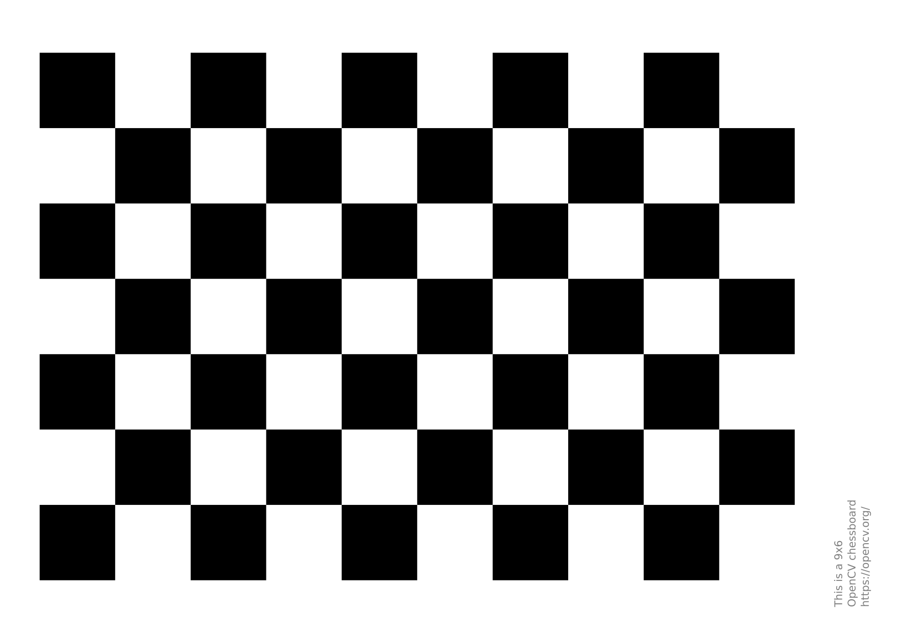
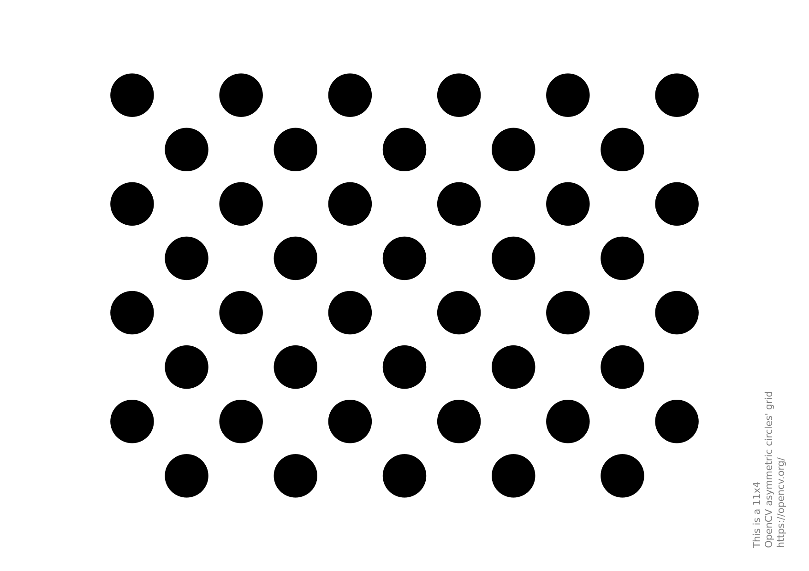
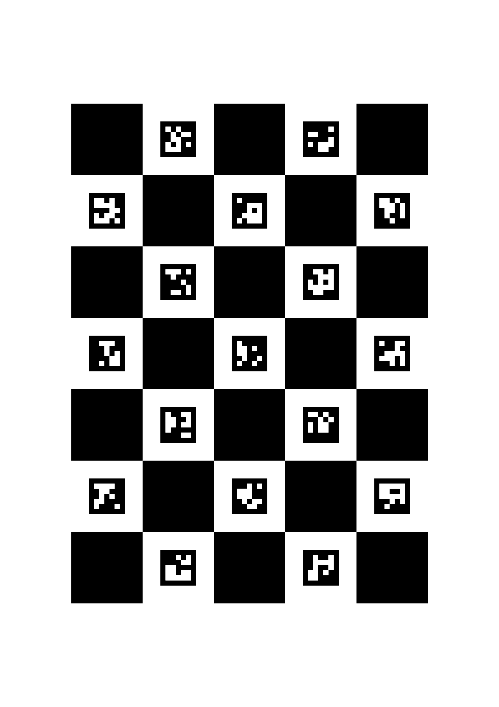

# CalibraVision

Aplicación de escritorio para **calibrar cámaras, estimar la pose de patrones y visualizar realidad aumentada** con C++17, Qt 6 y OpenCV.

Permite pasar de las capturas de un patrón físico a una calibración guardada, y utilizarla para dibujar un volumen y ejes sobre el vídeo en vivo. El ejecutable actual se llama `camera-lab`.

## Funcionalidades

- Selector de ajedrez, círculos asimétricos y ChArUco con imagen de referencia y parámetros específicos.
- Captura de vistas, rechazo de vistas similares y calibración con error de reproyección RMS.
- Estimación de pose y seis figuras: prisma, pirámide, cilindro, esfera, cono y toroide. Distancia al origen del patrón en milímetros y ejes X, Y y Z opcionales.
- Guardado y carga de calibraciones YAML con validación de parámetros y resolución.
- Captura y detección fuera del hilo de interfaz; calibración en una tarea independiente y vídeo mediante una textura OpenGL.

## Patrones disponibles

| Ajedrez | Círculos asimétricos | ChArUco |
| --- | --- | --- |
|  |  |  |
| Referencia de 9 × 6 esquinas interiores. | Referencia de 4 × 11 centros. | Referencia de 5 × 7 cuadrados y 24 esquinas interiores. |

Los patrones permiten localizar el tablero; las figuras y los ejes son la visualización de realidad aumentada. Puedes cambiar de figura durante el vídeo usando la misma calibración. ChArUco admite vistas parciales con al menos seis esquinas no colineales. El diccionario utilizado es `DICT_5X5_100`.

Consulta las medidas, fuentes y licencia de las imágenes en [app/imgs/README.md](app/imgs/README.md).

## Requisitos

- Compilador compatible con C++17 y CMake 3.20 o posterior.
- Qt 6.4 o posterior con Widgets y OpenGLWidgets.
- OpenCV 4.7 o posterior con `core`, `imgproc`, `calib3d`, `videoio`, `objdetect`, `features2d` e `imgcodecs`.
- Sesión gráfica y controlador con OpenGL 3.3; cámara accesible desde OpenCV.

La compilación y las pruebas se verificaron en Fedora 43 con OpenCV 4.11. Los patrones nuevos se comprobaron con imágenes digitales y datos sintéticos; su validación con cámara e impresión físicas sigue pendiente.

## Compilar y ejecutar

En Fedora, instala las dependencias:

```bash
sudo dnf install gcc-c++ cmake qt6-qtbase-devel opencv-devel
```

Desde la raíz del repositorio:

```bash
cmake -S app -B app/build -DCMAKE_BUILD_TYPE=Release
cmake --build app/build -j
ctest --test-dir app/build --output-on-failure
./app/build/camera-lab
```

En otros entornos, instala las bibliotecas de desarrollo respetando las versiones mínimas indicadas.

## Primer uso

1. Elige el patrón y configura sus dimensiones y medidas reales. La imagen del visor sirve como referencia antes de iniciar la cámara.
2. Inicia la cámara y captura al menos ocho vistas desde distintas posiciones, distancias e inclinaciones. Mantén fijo el enfoque y el zoom.
3. Calibra y revisa el RMS. Un error menor es preferible, pero no garantiza por sí solo una calibración precisa.
4. Selecciona una figura y activa la realidad aumentada. Puedes alternar las seis figuras y mostrar u ocultar los ejes sin recalibrar.
5. Guarda el YAML para reutilizarlo mediante **Cargar calibración…** con la misma cámara, resolución y enfoque/zoom.

| Atajo | Acción |
| --- | --- |
| `Espacio` | Capturar una vista. |
| `Ctrl+Enter` | Calibrar. |
| `Ctrl+O` | Cargar calibración. |
| `Ctrl+S` | Guardar calibración. |

Las calibraciones y las capturas de la sesión son distintas: el YAML guarda parámetros y metadatos, pero no recupera las imágenes ni las vistas usadas para calcularlos. Las calibraciones locales quedan excluidas de Git.

## Estructura y documentación

- [app/README.md](app/README.md): funcionamiento, arquitectura, parámetros, pruebas y límites.
- [app/imgs/README.md](app/imgs/README.md): patrones oficiales y configuración de referencia.
- [app/tests/vision_test.cpp](app/tests/vision_test.cpp): detección de los tres patrones, ChArUco parcial, calibración, pose, escala física y compatibilidad YAML.
- [main.cpp](main.cpp): programa original que sirvió de base; la aplicación de `app/` funciona de forma independiente.

Para comprobar la interfaz y OpenGL sin abrir la cámara:

```bash
./app/build/camera-lab --smoke-test /tmp/calibravision.png
```

## Contribuir

Para informar de un problema, incluye el sistema operativo, las versiones de Qt/OpenCV, el patrón y sus medidas, los pasos para reproducirlo y el comportamiento esperado. Si afecta al vídeo, indica también cámara y resolución.

Las contribuciones deben mantener los cambios acotados, ejecutar las pruebas de CTest y añadir cobertura cuando cambie la detección, la geometría o la persistencia de calibraciones.

## Licencias

Las imágenes oficiales de OpenCV se acompañan de su [licencia Apache 2.0](app/imgs/OPENCV_LICENSE) y sus fuentes. Esa licencia corresponde al material de OpenCV; el código propio de este repositorio todavía no tiene una licencia declarada.
